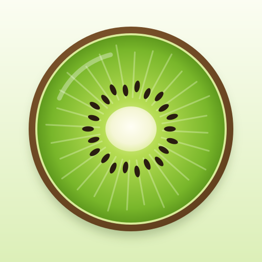
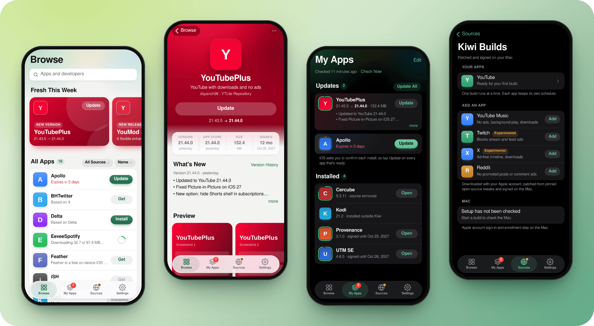
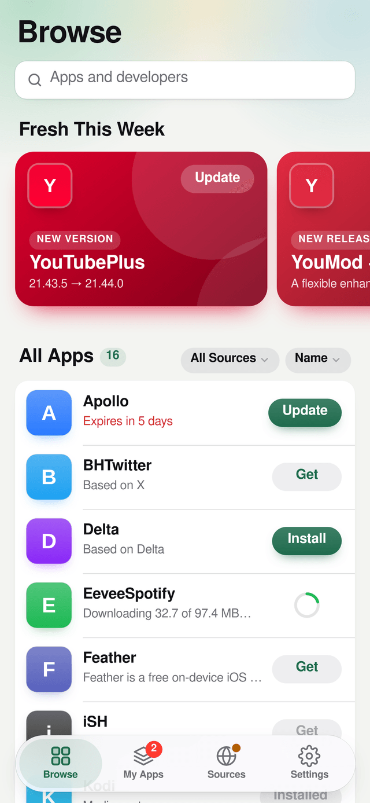
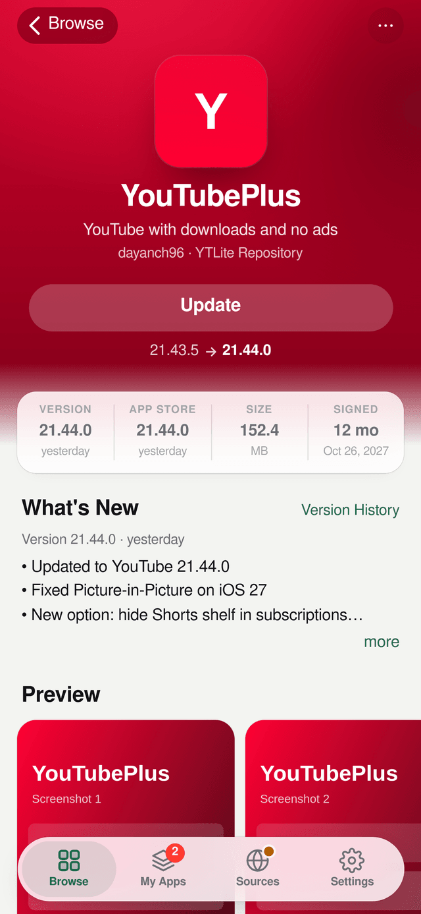
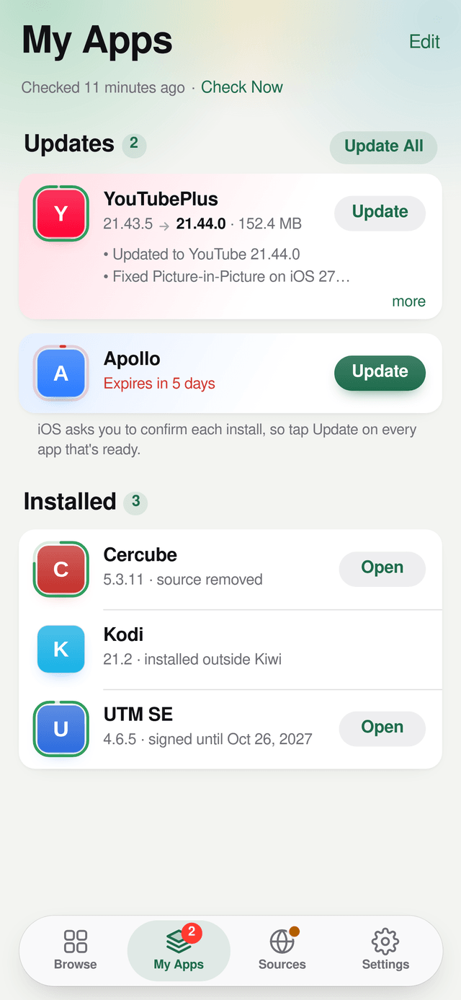
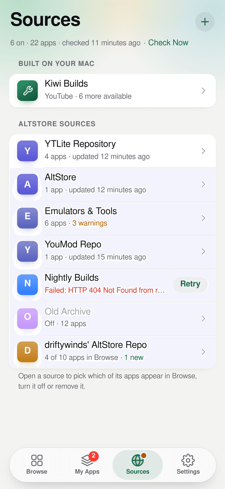
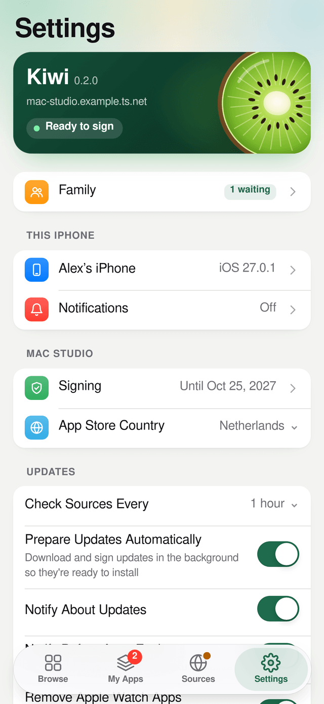
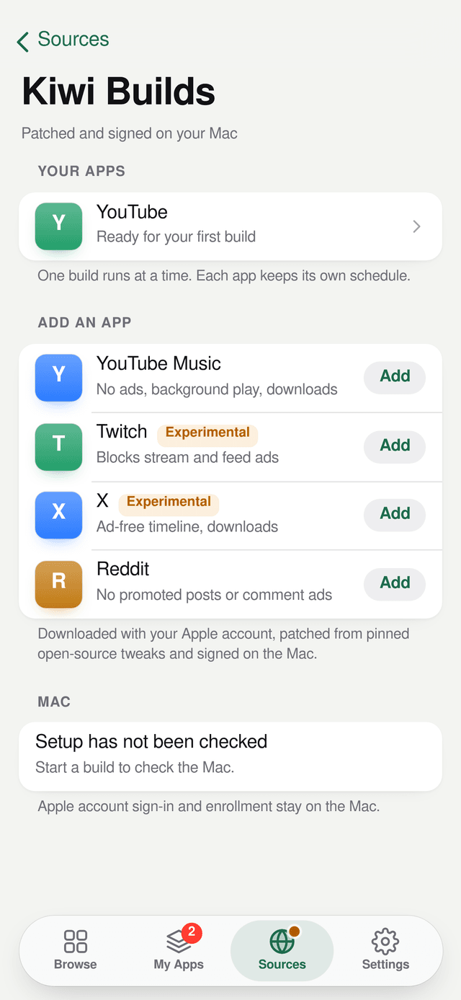
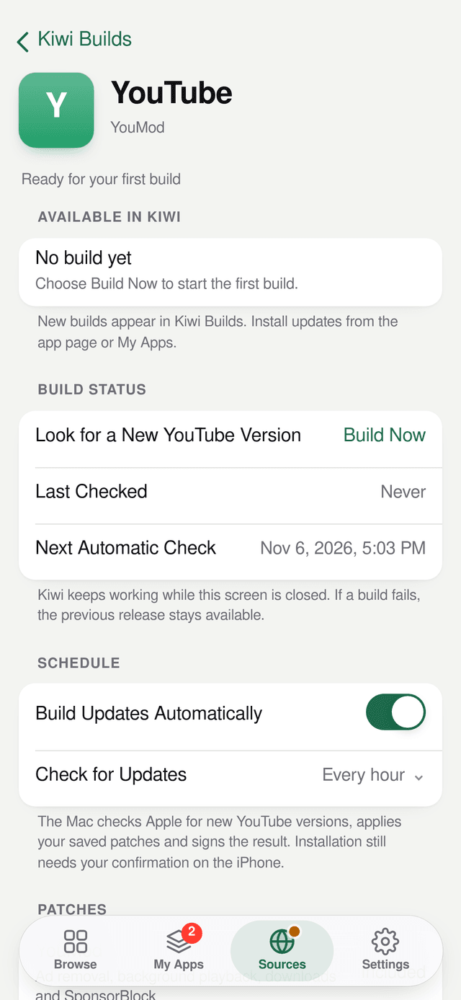
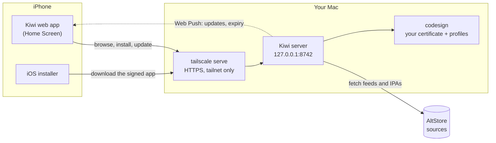

<p align="center">
  
</p>

<h1 align="center">Kiwi</h1>

<p align="center">
  <strong>Your own app store for sideloaded iPhone apps, running on your Mac or Linux server.</strong><br>
  Browse AltStore sources, sign apps with your own developer certificate and install them over the air on every iPhone in your tailnet.
</p>

<p align="center">
  <a href="https://github.com/DigitalPals/Kiwi/actions/workflows/ci.yml"></a>
  <a href="LICENSE"></a>
  
  
  
  
</p>

<p align="center">
  
</p>

Kiwi is a small server for your Mac (or a Linux computer) and a web app for your iPhone. It
reads [AltStore](https://altstore.io)-format sources, downloads the apps you pick, re-signs
them with your Apple Development certificate (on a Mac with Apple's own `codesign`), and serves them over
HTTPS on your [Tailscale](https://tailscale.com) network. On the iPhone you add Kiwi to the
Home Screen and install and update apps with one tap, with update badges and notifications.

There's no AltServer, no pairing file and no Apple ID handed to a third-party app. Signing
happens on your Mac with the certificate and profiles already in your keychain, and Kiwi
can only be reached from your own tailnet.

## Features

- **Browse AltStore sources.** Add any source URL (raw GitHub and `blob` links included;
  modern and legacy feeds). Search, sort, see what's fresh this week, and hide apps you
  don't want or show only the ones you pick.
- **Apps without a source.** Paste an app's download page or a link to its IPA. Kiwi
  picks up the page's AltStore source when it has one, and otherwise keeps checking the
  link for a new IPA.
- **One-tap installs and updates.** Kiwi signs the right release for each iPhone's iOS
  version and hands it to iOS's own installer. Updates can be downloaded and signed in the
  background, so they're ready when you tap **Update**.
- **Signing you can see.** My Apps shows how long each signature lasts, and Kiwi notifies
  you 30, 7 and 1 days before an app expires. An app's page lists the entitlements the
  profile can't grant before you install it.
- **A real Home Screen app.** Kiwi is a PWA with badges, Web Push notifications, light and
  dark mode and offline fallbacks.
- **App Store originals.** Patched apps show the App Store app they're based on and warn you
  when the App Store is ahead.
- **Kiwi Builds (optional, off by default).** Build patched YouTube, YouTube Music, Twitch,
  X and Reddit apps on your Mac from pinned open-source tweaks, on a schedule. It can also
  build patched YouTube, YouTube Music and Reddit for your Android devices.
- **Private by design.** Kiwi listens on `127.0.0.1` only. `tailscale serve` publishes it to
  your tailnet over HTTPS, never to the internet, and only your own Tailscale user can use it.

## Screenshots

<table>
  <tr>
    <td align="center" width="25%">
      <picture>
        <source media="(prefers-color-scheme: dark)" srcset="docs/screenshots/browse-dark.png">
        
      </picture>
      <br><sub><b>Browse</b> every source in one place</sub>
    </td>
    <td align="center" width="25%">
      <picture>
        <source media="(prefers-color-scheme: dark)" srcset="docs/screenshots/app-dark.png">
        
      </picture>
      <br><sub><b>App pages</b> in each app's colours</sub>
    </td>
    <td align="center" width="25%">
      <picture>
        <source media="(prefers-color-scheme: dark)" srcset="docs/screenshots/apps-dark.png">
        
      </picture>
      <br><sub><b>My Apps</b>: updates and signing timers</sub>
    </td>
    <td align="center" width="25%">
      <picture>
        <source media="(prefers-color-scheme: dark)" srcset="docs/screenshots/sources-dark.png">
        
      </picture>
      <br><sub><b>Sources</b>: any AltStore feed</sub>
    </td>
  </tr>
  <tr>
    <td align="center">
      <picture>
        <source media="(prefers-color-scheme: dark)" srcset="docs/screenshots/settings-dark.png">
        
      </picture>
      <br><sub><b>Settings</b>: signing, updates and more</sub>
    </td>
    <td align="center">
      <picture>
        <source media="(prefers-color-scheme: dark)" srcset="docs/screenshots/builds-dark.png">
        
      </picture>
      <br><sub><b>Kiwi Builds</b> (optional)</sub>
    </td>
    <td align="center">
      <picture>
        <source media="(prefers-color-scheme: dark)" srcset="docs/screenshots/build-dark.png">
        
      </picture>
      <br><sub><b>Patches and schedules</b> per app</sub>
    </td>
  </tr>
</table>

<sub>Screenshots use Kiwi's built-in demo data; app icons are placeholders.</sub>

## How it works



1. Kiwi checks your sources on a schedule and works out, per iPhone, what you can install
   or update. Tailscale tells it which device is asking; only your own devices get in.
2. When you tap **Get** or **Update**, Kiwi downloads and checks the IPA and re-signs it
   with your Apple Development identity and a matching development profile.
3. iOS installs it from Kiwi's HTTPS address with an over-the-air manifest
   (`itms-services`), the same way enterprise and TestFlight-style installs work.

More detail: [architecture](docs/architecture.md).

## Requirements

| | |
|---|---|
| **Server** | An always-on Mac you can stay logged in to (Kiwi runs in your login session so `codesign` can use your keychain). Tested on macOS 27 with Xcode 27 on Apple Silicon. Or a Linux computer or VM with systemd or Docker ([Linux](docs/install.md#linux), [Docker](docs/install.md#docker)); Kiwi Builds builds patched iOS apps on a Mac only. |
| **Apple** | An [Apple Developer Program](https://developer.apple.com/programs/) membership, with an Apple Development certificate and a development profile that includes your iPhones. [The install guide](docs/install.md#2-signing-certificate-and-profile) walks you through it. |
| **Tailscale** | Tailscale on the Mac and on every iPhone, with MagicDNS and HTTPS certificates turned on for your tailnet. |
| **Build tools** | Xcode (or its command line tools), [Rust](https://rustup.rs) and Node.js 20 or later. `install.sh` checks them all. |
| **iPhone** | iOS 16 or later; iOS 16.4 or later for notifications. Developer Mode turned on. |

## Install

Plan on about half an hour, most of it in Apple's developer portal.
[The install guide](docs/install.md) has every step in detail.

1. **Prepare the Mac.** Install Xcode, [Rust](https://rustup.rs) and Node.js. Create an
   **Apple Development** certificate (Xcode › Settings › Accounts › Manage Certificates),
   register your iPhones' UDIDs on [developer.apple.com](https://developer.apple.com/account/resources/devices/list)
   and create a wildcard (`*`) **iOS App Development** profile that includes them, then
   double-click the downloaded profile. ([How](docs/install.md#2-signing-certificate-and-profile))
2. **Set up Tailscale** on the Mac and on your iPhones, and turn on **MagicDNS** and
   **HTTPS Certificates** on the [DNS page](https://login.tailscale.com/admin/dns) of the
   admin console.
3. **Install Kiwi.** On the Mac, in Terminal:

   ```sh
   git clone https://github.com/DigitalPals/Kiwi.git kiwi && cd kiwi
   ./install.sh --check    # checks the Mac and shows what it will install; changes nothing
   ./install.sh            # builds Kiwi, installs it as a LaunchAgent and publishes it on your tailnet
   ```

   The installer ends with Kiwi's address, such as `https://your-mac.your-tailnet.ts.net`.
4. **Add Kiwi to your iPhone.** Open that address in Safari, tap **Share › Add to Home
   Screen** and open Kiwi from the Home Screen. Settings should say **Ready to sign**.
5. **Install your first app.** In **Sources**, tap **+** and paste an AltStore source URL
   (or an app's download page, or a link to an IPA).
   Tap **Get** on an app in **Browse** and confirm when iOS asks. The first time you open
   an app Kiwi signed, iOS asks you to turn on **Developer Mode** (Settings › Privacy &
   Security).

On Linux, `./install.sh` installs Kiwi as a systemd service the same way, and
`compose.yaml` runs it in Docker next to a Tailscale container; see
[the install guide](docs/install.md#linux).

To update Kiwi, run `git pull && ./install.sh` in the clone: it backs up Kiwi's database
and rolls back if the new version doesn't start. To remove it, run `./uninstall.sh` (add
`--purge` to delete its data and logs too). Installed apps keep working until their
signature expires.

## Using Kiwi

| Tab | |
|---|---|
| **Browse** | Every app from your sources, with **Fresh This Week** on top. Search, sort, filter by source, and hide apps you don't want (**•••** › **Hide from Browse**). |
| **My Apps** | Updates, the apps you installed and how long each signature lasts. **Update All** prepares every update; iOS asks you to confirm each install. |
| **Sources** | Add, turn off or remove AltStore sources, and show all of a source's apps or only the ones you pick. Kiwi Builds lives here too. |
| **Settings** | Signing, notifications, update checks, the App Store country, this iPhone's link to the Mac and Kiwi Builds. |

Updates, installs that are ready and apps about to expire can notify you (iOS 16.4 or
later, from the Home Screen app). More in [Using Kiwi](docs/using-kiwi.md).

## Documentation

| Guide | |
|---|---|
| [Install](docs/install.md) | Everything from the signing certificate to the first install on your iPhone |
| [Using Kiwi](docs/using-kiwi.md) | Sources, Browse, installs and updates, signing, notifications, settings |
| [Kiwi Builds](docs/kiwi-builds.md) | The optional patched-app builder: what it does, Mac setup, the apps |
| [Operations](docs/operations.md) | Where everything lives, configuration, logs, backups, updating, rolling back |
| [Troubleshooting](docs/troubleshooting.md) | Fixes for the usual problems |
| [Architecture](docs/architecture.md) | How Kiwi is put together, signing and security |
| [HTTP API](docs/api.md) | The API between the server and the web app |
| [Development](docs/development.md) | Building, testing, the demo mode and contributing |

## FAQ

**Does the Mac have to stay on?** For installing and updating, yes (the same goes for a
Linux server). Installed apps keep working until their signature expires (when your
development profile or certificate expires, usually after a year), and Kiwi reminds you
before then.

**Does it work away from home?** Yes. Anywhere your iPhone is connected to your tailnet.

**Can I use a free Apple account?** Kiwi signs with a development certificate and a
development profile, and a wildcard profile is what lets it sign any app. Free accounts
can't create those, so plan on a paid membership.

**Can other people on my tailnet use it?** No. Kiwi is for one person: the Tailscale user
who owns the Mac. Anyone else who opens it sees that it's yours, and can't browse, install
or change anything.

**Does Kiwi send my apps or data anywhere?** No. Kiwi talks to the sources you add, Apple
(App Store versions) and the Web Push service of your devices. Everything else stays on
your Mac. Kiwi Builds, when you turn it on, also downloads the apps, tweaks and tools it
builds from; [its guide](docs/kiwi-builds.md) names each service.

## Disclaimer

Kiwi is an independent project. It is not affiliated with Apple, AltStore or Tailscale.
Install only apps you trust and are allowed to use. Kiwi Builds modifies App Store apps and
may break their terms of service; it is off unless you turn it on, and it's for your own
devices only. See [Kiwi Builds](docs/kiwi-builds.md) before you use it.

## License

[MIT](LICENSE)
